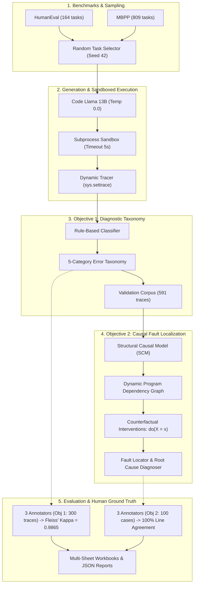

# A Diagnostic Model and Causal Root Cause Analysis Framework for LLM-Generated Code

[](https://www.python.org/downloads/)
[](LICENSE)
[](REPRODUCIBILITY.md)
[](REPRODUCIBILITY.md)

This repository contains the complete experimental artifacts, dataset corpora, human annotation studies, source code, and reproduction scripts accompanying the research paper:

> **"A Diagnostic Model and Causal Root Cause Analysis Framework for Large Language Model (LLM)-Generated Code"**

---

## Table of Contents

- [Research Overview](#research-overview)
- [System Architecture](#system-architecture)
- [Repository Organization](#repository-organization)
- [Quick Start: 1-Minute Reproducibility Verification](#quick-start-1-minute-reproducibility-verification)
- [Environment Setup & Installation](#environment-setup--installation)
- [Running Objective 1: Automated Error Classification](#running-objective-1-automated-error-classification)
- [Running Objective 2: Causal Fault Localization](#running-objective-2-causal-fault-localization)
- [Running Unit Tests](#running-unit-tests)
- [Empirical Results Summary](#empirical-results-summary)
- [Full Generative Pipeline with Ollama (Optional)](#full-generative-pipeline-with-ollama-optional)
- [Paper-to-Artifact Mapping](#paper-to-artifact-mapping)
- [Citation](#citation)
- [License](#license)

---

## Research Overview

Large language models (LLMs) frequently generate syntactically plausible code that fails test assertions or triggers runtime exceptions. Understanding *why* generated programs fail and *where* bugs originate requires moving beyond binary pass/fail outcomes to granular diagnostic reasoning.

This project implements and evaluates an end-to-end framework across two primary research objectives:

1. **Objective 1 — Diagnostic Error Taxonomy & Automated Classification**:
   - Classifies execution failures into a formal five-category taxonomy: **Syntax Error**, **Runtime Exception**, **Wrong-Output Error**, **Assertion Failure**, and **Timeout Error** (plus **Correct** for passing code).
   - Validated against a held-out validation corpus of **300 execution traces** generated from standard benchmarks (**HumanEval** and **MBPP**) using Code Llama 13B.
   - Evaluated against three independent human annotators with **Fleiss' Kappa** inter-annotator agreement ($\kappa = 0.9865$, indicating almost perfect agreement) and achieving **99.67%** automated classifier accuracy against human consensus.

2. **Objective 2 — Causal Root Cause Analysis & Fault Localization**:
   - Leverages a **Structural Causal Model (SCM)**: $\text{Specification} \to \text{Code} \to \text{Trace} \to \text{Outcome}$.
   - Constructs dynamic **Program Dependency Graphs (PDGs)** combining static AST data/control dependencies with runtime event traces (`sys.settrace`).
   - Implements Pearl's counterfactual intervention engine ($do(X = x)$) in safe process sandboxes to test candidate causal variables.
   - Evaluated against multi-annotator human ground truth on **100 held-out execution failure tasks** (achieving 100% human fault line agreement).

---

## System Architecture



---

## Repository Organization

```
Experiment/
├── README.md                          # Comprehensive project documentation (this file)
├── REPRODUCIBILITY.md                 # Dedicated reviewer reproducibility guide & checklist
├── evaluate_reproducibility.py        # 1-minute verification script for all paper metrics
├── requirements.txt                   # Project dependencies (openpyxl, requests, pandas)
├── LICENSE                            # MIT License
├── CITATION.cff                       # Citation metadata for GitHub
├── .gitignore                         # Git ignore configuration
│
├── Annotator_respond/                 # Raw annotator response workbooks
│   ├── James_classified.xlsx
│   └── Pius_classified.xlsx
│
└── LLM_ExecutionTrace_Project/         # Main research codebase and experimental data
    ├── main.py                        # CLI entry point for Objective 1 pipeline
    ├── config.py                      # Global configuration & paths
    ├── models.py                      # Core dataclasses (Task, ExecutionResult, ErrorCategory)
    ├── experiment.json                # Hardware, environment, and model metadata
    ├── experiment.log                 # Full execution log of the experimental run
    │
    ├── datasets/                      # Benchmark datasets
    │   ├── HumanEval.csv              # 164 HumanEval coding tasks
    │   └── sanitized-mbpp.json        # 809 sanitized MBPP coding tasks
    │
    ├── selected_tasks/                # Sampled task lists (Seed 42)
    │   ├── humaneval_150.csv
    │   └── mbpp_150.csv
    │
    ├── prompts/                       # 300 assembled Code Llama prompts
    ├── generated_code/                # 300 raw LLM-generated Python programs
    ├── execution_logs/                # Per-task execution trace JSONs
    │
    ├── executor/                      # Execution sandboxing & runtime capture
    │   ├── runner.py
    │   ├── sandbox.py
    │   ├── test_runner.py
    │   ├── timer.py
    │   └── trace_capture.py
    │
    ├── parser/                        # Objective 1 rule-based classifier
    │   ├── classifier.py
    │   ├── rules.py
    │   └── taxonomy.py
    │
    ├── annotation/                    # Exported corpora & human annotations
    │   ├── Validation_Corpus.json     # Full validation corpus (591 traces)
    │   ├── Validation_Corpus.xlsx     # Styled validation corpus
    │   ├── Validation_Corpus_100.json # 100-case held-out subset for Objective 2
    │   ├── obj1_response/             # Objective 1 annotator responses & consensus
    │   │   ├── Annotation_Abayomi.xlsx
    │   │   ├── Annotation_James.xlsx
    │   │   ├── Annotation_John.xlsx
    │   │   └── obj_1_Annotation_response.xlsx
    │   └── obj2_response/             # Objective 2 annotator responses & consensus
    │       ├── Annotator_Task_100_Abayomi.xlsx
    │       ├── Annotator_Task_100_James.xlsx
    │       ├── Annotator_Task_100_John.xlsx
    │       └── obj_2_Annotation_response.xlsx
    │
    └── objective2/                    # Objective 2: Causal Diagnosis Engine
        ├── main.py                    # Objective 2 CLI entry point
        ├── pipeline.py                # End-to-end causal diagnosis pipeline
        ├── models.py                  # SCM, PDG, and counterfactual data models
        ├── config.py                  # Objective 2 parameters
        ├── scm/                       # Structural Causal Model construction
        ├── pdg/                       # Static AST + dynamic sys.settrace PDG
        ├── counterfactual/            # Counterfactual intervention engine: do(X=x)
        ├── fault_localization/        # Candidate generation & ranking
        ├── annotation/                # Fleiss' Kappa and ground truth loader
        ├── output/reports/            # Diagnostic reports & Objective2_Results.xlsx
        └── tests/                     # Objective 2 automated test suite (10 tests)
```

---

## Quick Start: 1-Minute Reproducibility Verification

To immediately verify all key claims, dataset files, annotator agreement metrics, and unit tests without re-running long computations:

```bash
# From repository root:
python evaluate_reproducibility.py
```

This single command:
1. Verifies dataset and corpus files.
2. Computes Fleiss' Kappa across 3 human annotators on 300 validation traces ($\kappa = 0.9865$).
3. Verifies automated classifier accuracy against human ground truth ($299/300 = 99.67\%$).
4. Evaluates Objective 2 multi-annotator fault line agreement ($100/100 = 100.0\%$).
5. Runs all 10 unit tests for the causal diagnosis engine ($10/10\text{ passed}$).

---

## Environment Setup & Installation

### Requirements
- **Python**: 3.10 or higher.
- **Dependencies**: Only 3 lightweight packages (`openpyxl`, `requests`, `pandas`).

### Installation

```bash
# Clone the repository
git clone <REPOSITORY_URL>
cd <REPOSITORY_NAME>

# Create a virtual environment (recommended)
python -m venv .venv

# Activate the virtual environment
# On Linux/macOS:
source .venv/bin/activate
# On Windows (PowerShell):
.venv\Scripts\Activate.ps1
# On Windows (cmd):
.venv\Scripts\activate.bat

# Install dependencies
pip install -r requirements.txt
```

---

## Running Objective 1: Automated Error Classification

Objective 1 maps execution failures to the formal error taxonomy:

```bash
cd LLM_ExecutionTrace_Project

# Run automated classification across captured execution logs
python main.py classify

# Export updated multi-format validation corpora (Excel, CSV, JSON)
python main.py export
```

Exported corpora will be updated in `annotation/Validation_Corpus.*`.

---

## Running Objective 2: Causal Fault Localization

Objective 2 carries out causal diagnosis and fault localization on failing programs using SCM, dynamic PDGs, and counterfactual interventions ($do(X=x)$).

```bash
cd LLM_ExecutionTrace_Project

# Run on the 100 held-out evaluation tasks
python -m objective2.main --input annotation/Validation_Corpus_100.json

# Analyze a quick sample (e.g. first 5 cases with verbose output)
python -m objective2.main --limit 5 --verbose

# Run on a specific task (e.g. HE001)
python -m objective2.main --task-id HE001 --verbose
```

### Inspecting Output Reports

Detailed artifacts are saved in `objective2/output/`:
- `reports/Objective2_Results.xlsx`: Multi-sheet workbook (`Summary`, `Causal_Diagnosis`, `PDG_Evidence`, `Counterfactual_Results`, `Fault_Location`, `Runtime_Evidence`, `Ground_Truth`, `Error_Analysis`).
- `reports/fault_location_results.csv`: Ranked fault lines and confidence scores.
- `reports/counterfactual_results.csv`: Full intervention log.
- `pdg/` & `scm/`: Per-task JSON and Graphviz `.dot` causal graphs.

---

## Running Unit Tests

Run the complete test suite for Objective 2 (static AST parser, dynamic `sys.settrace` tracer, PDG graph builder, SCM structural model, counterfactual engine, and fault locator):

```bash
cd LLM_ExecutionTrace_Project
python -m unittest discover -s objective2/tests
```

Expected result:
```text
Ran 10 tests in ~0.8s
OK
```

---

## Empirical Results Summary

### Objective 1: Diagnostic Taxonomy & Classification

| Metric | Result | Interpretation |
|---|---|---|
| **Evaluated Traces** | 300 held-out tasks | HumanEval & MBPP |
| **Human Annotators** | 3 independent annotators | Experienced Python developers |
| **Inter-Annotator Agreement** | **$\kappa = 0.9865$** (Fleiss' Kappa) | *Almost Perfect Agreement* (Landis & Koch, 1977) |
| **Classifier Accuracy vs Human GT** | **$299 / 300$ ($99.67\%$)** | Single discrepancy on HE052 |

#### Error Distribution on the 300 Traces:
- **Runtime Exception**: 179 traces ($59.7\%$)
- **Wrong-Output Error**: 118 traces ($39.3\%$)
- **Syntax Error**: 2 traces ($0.7\%$)
- **Timeout Error**: 1 trace ($0.3\%$)

### Objective 2: Causal Fault Localization

| Metric | Result |
|---|---|
| **Evaluated Cases** | 100 execution failure cases |
| **Annotator Agreement on Fault Line** | **$100 / 100$ ($100.0\%$)** 3-way consensus |
| **Analyzed Cases in Full Corpus** | 378 failing programs |
| **Counterfactual Interventions Tested** | 677 interventions ($do(X=x)$) |
| **Successful Counterfactual Repairs ($FAIL \to PASS$)** | 47 programs ($6.9\%$) |
| **Exact-Line Fault Match** | $30 / 99$ ($30.3\%$) |

---

## Full Generative Pipeline with Ollama (Optional)

All pre-generated code files (`generated_code/`), prompts (`prompts/`), and execution traces (`execution_logs/`) are packaged in this repository so reviewers can verify all results without a local GPU.

To re-run code generation from scratch using Ollama:

1. Install [Ollama](https://ollama.ai) and pull the model:
   ```bash
   ollama pull codellama:13b
   ollama serve
   ```
2. Execute the full pipeline:
   ```bash
   cd LLM_ExecutionTrace_Project
   python main.py run-all
   ```

---

## Paper-to-Artifact Mapping

| Paper Section | Topic | Artifact Location |
|---|---|---|
| **Section 3.1 / 4.2** | Benchmark Datasets | `LLM_ExecutionTrace_Project/datasets/HumanEval.csv`, `sanitized-mbpp.json` |
| **Section 3.2** | Task Selection | `LLM_ExecutionTrace_Project/selected_tasks/` |
| **Section 3.3** | Generation & Prompts | `LLM_ExecutionTrace_Project/prompts/`, `generated_code/` |
| **Section 3.4** | Execution Sandboxing | `LLM_ExecutionTrace_Project/executor/` |
| **Section 3.5 / 4.3** | Error Taxonomy & Classifier | `LLM_ExecutionTrace_Project/parser/`, `annotation/Validation_Corpus.*` |
| **Section 4.3.1** | Human Annotations (Obj 1) | `LLM_ExecutionTrace_Project/annotation/obj1_response/` |
| **Section 4.3.2** | Fleiss' Kappa Inter-Rater Agreement | `LLM_ExecutionTrace_Project/objective2/annotation/fleiss_kappa.py` |
| **Section 4.4 / Obj 2** | Structural Causal Model (SCM) | `LLM_ExecutionTrace_Project/objective2/scm/` |
| **Section 4.4 / Obj 2** | Dynamic PDG (`sys.settrace`) | `LLM_ExecutionTrace_Project/objective2/pdg/` |
| **Section 4.4 / Obj 2** | Counterfactual Engine | `LLM_ExecutionTrace_Project/objective2/counterfactual/` |
| **Section 4.5** | Fault Localization Reports | `LLM_ExecutionTrace_Project/objective2/output/reports/` |
| **Section 4.5.1** | Human Ground Truth (Obj 2) | `LLM_ExecutionTrace_Project/annotation/obj2_response/` |

---

## Citation

If you use this artifact, datasets, or code in your research, please cite:

```bibtex
@article{diagnostic_llm_code_2026,
  title   = {A Diagnostic Model and Causal Root Cause Analysis Framework for Large Language Model-Generated Code},
  author  = {Anonymous Authors},
  journal = {Submitted for Peer Review},
  year    = {2026}
}
```

---

## License

This project is licensed under the [MIT License](LICENSE).
